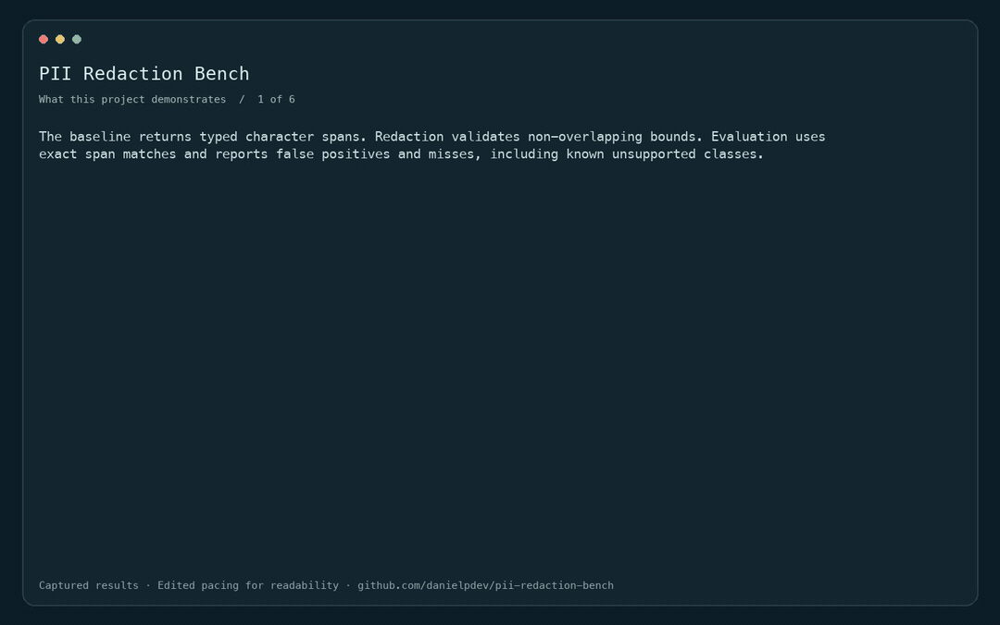
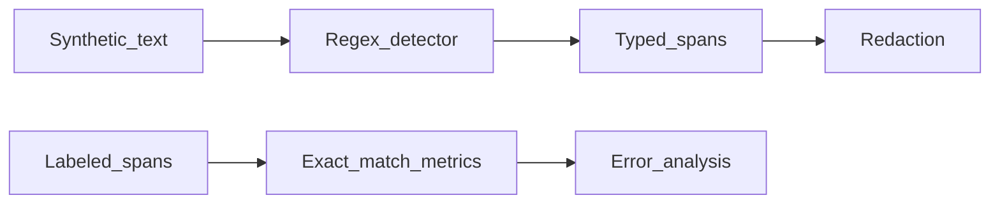

# PII Redaction Bench

Span-level evaluation of synthetic PII detection and masking.

[](https://github.com/danielpdev/pii-redaction-bench/actions/workflows/ci.yml)

**Role focus:** AI Evaluation / Data Processing. **Status:** working local portfolio implementation, with synthetic data.

## Demo



Edited replay of captured CLI outputs in deterministic fixture mode. This is not live model inference. [Full recording](docs/demo.mp4). Rebuild with `./scripts/render_gif.sh` (FFmpeg required).

## The engineering decision

The baseline returns typed character spans. Redaction validates non-overlapping bounds. Evaluation uses exact span matches and reports false positives and misses, including known unsupported classes.



## Run locally

Requirements: Python 3.12, [uv](https://docs.astral.sh/uv/getting-started/installation/) and Make.

```bash
git clone https://github.com/danielpdev/pii-redaction-bench.git
cd pii-redaction-bench
make setup
make demo
make test
make eval
```

`make demo` uses an isolated temporary database where relevant, so it is safe to repeat. `make eval` writes a timestamped report to `reports/evaluation-fixture.json`. Fixture mode is deterministic and does not represent model inference. There is no recurring hosting or API subscription cost.

This is a CLI project; `make demo` and `make eval` are its entry points.

[Watch the recorded demo](docs/demo.mp4) · [Reproduce the walkthrough](docs/DEMO.md)

## Verification and evidence

Exact offsets, no ticket-number false positive, rejected overlapping spans and no partial credit for an incorrect boundary. Known name and obfuscated-email misses remain in the report.

- [Evaluation report](reports/evaluation-fixture.json) — measured during an actual run; inspect the mode and dataset size.
- [Development and authorship](docs/DEVELOPMENT.md).
- [Romanian interview preparation](docs/INTERVIEW_RO.md).
- [Design notes](docs/DESIGN.md).
- [Demo walkthrough](docs/DEMO.md).

CI uses standard GitHub-hosted runners and deterministic tests without downloading LLM weights. The lockfiles record exact package versions. Local-model results, when present, live in `reports/evaluation-local.json`; hardware/model identities are in `reports/environment.json`.

## Limits and next iteration

Regex support is intentionally limited to formatted emails and one phone pattern. This is not certified anonymization and must not be used as a privacy guarantee. All examples are synthetic.

Next: Add a local NER model and independently labeled multilingual data; compare recall and over-redaction.

The local demonstration does not include production authentication, secret management or operational service guarantees. Bind it to localhost and use synthetic data. These projects demonstrate engineering decisions; they do not claim real customers, paid production deployments or guaranteed interviews.

## Project ownership

Implemented with Codex assistance for Daniel Popa. The owner should review the code, run it, make an independent change and rehearse the tradeoffs before presenting it at interview. That human understanding check is pending and cannot be verified automatically. See [development notes](docs/DEVELOPMENT.md).

MIT for original source; dependencies/models retain their own licenses. See [third-party notices](THIRD_PARTY.md).
